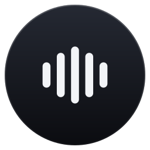

<p align="center">
  
</p>

<h1 align="center">LibreWave</h1>

<p align="center">Device control and a software mixer for the Elgato Wave:3 on Linux.</p>

LibreWave controls the Wave:3 hardware and provides a software mixer for it, like Wave Link does on Windows and macOS. It reads and changes the microphone gain, the headphone level, mute, Clipguard, Low-cut, and Gain Lock. The mixer has separate Monitor and Stream mixes and can route each application to its own input.

LibreWave is written in Rust. The device and mixer code is portable. Linux is the only supported platform.

## Features

- Hardware controls with exact protocol checks. LibreWave reads every change back and refuses writes to unknown firmware layouts.
- Inputs for Microphone and System, plus up to ten software inputs. Each input has a Monitor fader and a Stream fader.
- A Monitor mix for the Wave:3 headphones and a Stream mix that other applications can record.
- Saved application rules. LibreWave moves an application's streams to its input when the application plays, including Flatpak applications.
- Default inputs for Music, Browser, Voice Chat, and Game, with installed applications assigned on first run.
- Desktop volume changes the software mixer, not the hardware gain or headphone level.
- Clean start and stop. Stopping LibreWave restores the previous desktop audio setup.

## Programs

- `librewaved` is the user-session daemon. It is the only program that talks to the device and owns the audio graph, the profiles, and the recovery state.
- `librewavectl` is the command-line interface. Every operation is available here.
- `librewave` is the optional desktop application. It uses the same local interface as the CLI.

## Install

You need PipeWire, WirePlumber, systemd, a local desktop session, and the Rust toolchain from `rust-toolchain.toml`. Install the build packages listed in [docs/setup.md](docs/setup.md), then run these commands from the checkout:

```text
cargo build --release -p librewavectl -p librewaved -p librewave
target/release/librewavectl setup --desktop --autostart --source-root . --profile release
```

Setup prints its plan and asks for confirmation. It asks for your password once, to install a udev rule that gives your session access to the Wave:3. Then open LibreWave from your application menu.

To remove LibreWave, run `librewavectl stop` and then `librewavectl uninstall`. [docs/setup.md](docs/setup.md) explains every step and file.

## Documentation

- [Install, run, and remove LibreWave](docs/setup.md)
- [Desktop application](docs/ui.md)
- [Architecture](docs/architecture.md)
- [Linux audio integration](docs/linux-audio.md)
- [Hardware safety](docs/hardware-safety.md)
- [Protocol evidence](docs/protocol-evidence.md)
- [Wave Link behavior parity](docs/behavior-parity.md)
- [Roadmap](docs/roadmap.md)

## Safety

LibreWave has no firmware update, DFU, bootloader, or reset commands. Hardware writes use a reviewed allowlist, start from a complete device baseline, and are read back. Unknown firmware stays read-only.

Do not use a development build to try undocumented writes on another person's hardware. Read `AGENTS.md` before you change device or audio code.

## Status

LibreWave is in beta. It is tested on Fedora 44 with KDE Plasma and a Wave:3 with API 5.4. Physical reconnect, sleep, and login recovery are not yet tested. The [roadmap](docs/roadmap.md) lists the remaining work.

Releases are source builds. Native RPM, Arch, and Debian packages may follow. Flatpak and AppImage are outside the project scope.

## Project name and trademarks

LibreWave is an independent project. It is not affiliated with, endorsed by, or supported by Elgato or Corsair. Elgato, Wave, and Wave Link are trademarks of their owners.

LibreWave does not contain Wave Link artwork, branding, application binaries, or other proprietary assets.

## License

LibreWave is available under the [MIT License](LICENSE).
