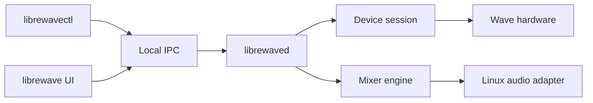

# Architecture

Status: approved baseline for the Linux implementation.

## Product boundary

LibreWave is a user-session audio service with two clients. The daemon owns the hardware, audio graph, saved state, and recovery process. The CLI and desktop application send commands to the daemon and subscribe to state changes.

Because of this split, the microphone and mixer keep working when the desktop window is closed. There is also only one normal hardware writer.

The local interface uses a Unix domain socket under the user's runtime directory. It does not listen on a network interface. The daemon checks the credentials of the connecting process, and every request and event carries a version.

## Workspace boundaries

| Package | Responsibility | Must not contain |
| --- | --- | --- |
| `librewave-protocol` | Message schemas, codecs, field validation, generated protocol catalog | USB I/O, device policy, platform APIs |
| `librewave-device` | Device capabilities, exact-version sessions, state shadow, safe transactions | libusb, ALSA, PipeWire, UI code |
| `librewave-core` | Profiles, commands, events, channel identifiers, mix semantics | USB packets, platform object identifiers |
| `librewave-engine` | Audio graph semantics, DSP, metering, bounded control transfer | GUI state, blocking I/O, hardware policy |
| `librewave-ipc` | Versioned requests, responses, snapshots, subscriptions, errors | Device access, storage, platform APIs |
| `librewave-platform-linux` | USB transport, udev, ALSA, PipeWire, WirePlumber, hotplug, desktop entries | Product UI, cross-platform policy |
| `librewave-ui` | GPUI views, input handling, accessible controls | USB, ALSA, PipeWire, persistent authority |
| `librewaved` | Composition root, authority, reconciliation, recovery | Duplicated protocol or DSP logic |
| `librewavectl` | Complete command-line client, setup, diagnostics | A second hardware write path |
| `librewave` | Optional GPUI application | Required headless functionality |

A crate enters the workspace only when it has a real contract and tests. The repository does not create empty platform crates as promises of future support.

## Dependency direction

`librewave-protocol` and `librewave-core` are the lowest layers. Device sessions depend on the protocol crate. The engine depends on core types. IPC depends on the command and event vocabulary in the core crate.

The Linux platform crate implements the transport and audio-host traits. It may depend on the portable contracts, but portable crates do not depend on it.

The daemon composes these parts. The UI and CLI depend on IPC types and client code, not on daemon internals. The UI also reads installed desktop entries through `librewave_platform_linux::desktop_entries`. That module reads files from the XDG data directories and uses no audio service.

## State ownership

The daemon keeps one desired state and one observed state for each managed device and audio graph.

- Desired state comes from the active profile and accepted user commands.
- Observed state comes from device reads, device events, and Linux audio events.
- Reconciliation compares the two states and schedules bounded changes.
- A successful write updates observed state only after readback or a trusted device event.
- A failed write leaves desired state intact and reports the mismatch.
- Each control event records whether it came from the device, a LibreWave client, or the operating system. Reconciliation does not send a change back to its origin.

The UI and CLI receive immutable snapshots followed by ordered events. They do not keep an independent authoritative device model.

A Wave:3 hardware command names one reviewed control and includes the device generation that the daemon shows. The generation token contains a random daemon epoch and a device revision. The CLI uses the complete `epoch:revision` token shown by inspection, and the epoch has 32 lowercase hexadecimal digits. A token from an earlier daemon process is stale, even when the device revision is the same. The daemon rejects a stale generation. The transaction path also reads the complete device configuration before every write, so a physical change after the snapshot causes a stale-baseline failure instead of a merge.

The daemon keeps one admitted Linux USB connection for each managed Wave:3. `librewavectl devices inspect <id>` reads the complete configuration again on that connection. `librewavectl refresh` sends the `Refresh` IPC command. This command first updates the host inventory. It then reads each retained connection that is ready or locked by ambiguous persistence, in logical device ID order. `GetStatus` and `ListDevices` update the host inventory but do not read a retained hardware configuration.

Host-service observations run on one read-only probe worker. The daemon collects completed results without waiting for that worker. Before the first result, the service state is `not probed`. Each probe command has a 100 ms deadline and a 32 KiB limit for each output pipe. On timeout or cancellation, the worker terminates the probe process group and reaps the child. A failed status probe reports unavailable service state. A failed invocation probe reports no invocation identity.

Audio startup and recovery borrow the daemon's control owner for admission. Each attempt first checks that the physical PipeWire nodes are hidden. It then reconciles the exact inventory candidate and reads its complete configuration through the retained claimed USB handle. If no connection exists, the daemon opens and admits one through the same connection factory that observation uses. A stale candidate or a failed read stops the attempt before any PCM opens.

The lifecycle creates a non-cloneable `AudioAdmission` context only after this fresh check succeeds. Capture startup consumes that context. The audio backend has no USB reader or handle and cannot release the daemon's control claim. No admission result is cached for a later attempt. A configuration change found at this boundary updates the normal device generation before IPC resumes.

An unchanged configuration read does not advance the snapshot generation or the device generation. A changed read replaces the portable observed configuration, advances the device generation, and records `Device` as the origin. The read does not send a hardware write or change sparse desired state. A malformed read drops the retained connection and reports a failed admission. A disconnect also drops the connection and reports the device as disconnected.

A persistence-ambiguous connection stays retained and write-locked while configuration reads continue. A connection locked by failed or unverified restoration needs a new admission probe. Inspection drops that connection and uses the normal reopen, admission, and reconciliation path.

Desired hardware state contains only the controls that a client explicitly changed through LibreWave. The daemon stores it in `device-state.json` under the profile directory, in one strict schema. A command is recorded as pending before USB access. The daemon promotes it to managed state only after a verified apply or an unchanged result. A pending command left by a crash locks restoration for that topology.

## Software inputs

The mixer profile always contains Microphone (source ID 1) and System (source ID 2). It can also hold up to ten named software inputs, for at most 12 sources. A new software input takes the profile's next unused source ID, so a source ID is never reused within one profile.

With no saved mixer profile, the daemon builds the first-run profile with `MixerProfile::first_run`. That profile contains Microphone, System, and one software input for each `DefaultInput`: Music, Browser, Voice Chat, and Game. The Microphone monitor route starts disabled. The daemon then adds application rules from installed desktop entries through `librewave_platform_linux::desktop_entries::default_assignments`. The `Categories` key of each entry selects the input:

- `Game` selects Game.
- `InstantMessaging`, `Chat`, `Telephony`, or `VideoConference` selects Voice Chat.
- `WebBrowser` selects Browser.
- `Music`, or `Audio` together with `Player`, selects Music when `Video` is absent.

A native application is identified by the executable that `Exec` starts. A Flatpak application has no executable in its entry, so it is identified by its desktop ID, which is its app ID. The daemon does not save the first-run profile until the first accepted change.

`ResetMixer { expected_generation }` replaces the profile with the first-run defaults and reads the desktop entries again. The CLI command is `librewavectl mixer reset <generation>`. In the application, the control is **Settings > Audio > Reset configuration**, and it asks for confirmation first. The default software inputs get new source IDs, so no existing endpoint changes its meaning. The mixer generation advances. Desired hardware state does not change.

Add, remove, and reset change the input layout. The daemon accepts a layout change while audio is stopped with cleanup complete, or while the mixer is active. It refuses the change while audio is starting, recovering, or cleaning up. When audio is active, the adapter first prepares the new graph resources. The daemon then saves the complete profile and publishes the new mixer generation. A stale request or a failed save leaves the retained layout unchanged and cancels the prepared resources.

Each configured software input has one deliberate virtual sink named `librewave.input.<source-id>`. The DSP filter has a fixed set of 28 ports: two for System and for each of ten software input slots, plus six output ports. The adapter maps each stable source ID to a free slot and enables only the occupied slots. An input edit therefore keeps the existing graph nodes. The adapter validates mapped buffers before it reads them. Each input has its own connection tracker and drops detached samples from the first drain cycle. Scratch and source mappings are allocated before processing. The graph callback uses fixed-capacity arrays and bounded loops. Teardown removes every configured adapter and link after callback quiescence. The public microphone endpoint stays independent of the mix routes.

## Mixer controls

`SetMixerFaders` saves both channel levels in one profile revision and keeps the mute state of each route. The UI's link preference is an editing option of the window. It does not create another saved mixer state or a second write path.

`SetMixerOutput` changes one software mix output. The complete control snapshot contains the source routes and both output controls. The engine applies the output coefficient after the complete sum and before clipping and output metering. The microphone endpoint bypasses these output controls. Coefficients are compiled on the control thread, and the callback consumes one fixed-size snapshot.

The UI sends fader and hardware level changes through one queue with at most one request in flight. While a request is in flight, the UI keeps only the latest position and sends it after the response. Each hardware level request is a `SetWave3Control` built from the device generation in the current snapshot. The UI edits a software input from one **Edit input** pop-up, which contains rename, the application rules, and remove. Remove asks for confirmation in a dialog. A channel is reordered by dragging its handle, which sends `MoveMixerInput`.

The mixer state file, `mixer-state.json`, uses schema 3. The daemon refuses any other schema and does not reset it. `librewavectl convert-profile` converts a stopped schema-2 profile and keeps an exact backup. `librewavectl convert-profile --rollback` restores that backup.

## Meter observation

`GetMeters` returns software peak and RMS values separately from control snapshots. The real-time handoff holds one processed-block observation and never blocks the producer. The daemon consumes it every 100 ms. It converts amplitudes to linear millionths outside the audio callback and keeps a transient frame. A reading older than 350 ms becomes unavailable. Stop and a new audio attempt clear the old frame. No meter value is saved, and no meter value changes a device, mixer, or profile generation. The CLI command is `librewavectl mixer meters`.

## Application routing

The active graph observes playback streams through its existing PipeWire registry connection. It groups streams by the `application.id` of the stream node, or by its `application.process.binary` when no valid application ID exists. When the node has neither, the daemon reads the full properties of the client that created the stream. It uses the client's `pipewire.access.portal.app_id`, then `application.id`, then `application.process.binary`. PipeWire sets the portal app ID from the sandbox, so a Flatpak application cannot change it. The observed Flatpak Spotify stream names only `application.name` on its node and is grouped as `com.spotify.Client`. The daemon does not use process IDs or window titles. A stream without any of these identities stays unassigned. Observation is limited to 128 streams. Routing refuses an incomplete list above that limit.

`GetApplications` returns a transient list. Its generation identifies the daemon process, the audio attempt, and the registry revision. `RouteApplication` rejects stale requests and permits only configured LibreWave input sinks. It writes `target.object` in the default metadata. WirePlumber owns the resulting links. LibreWave does not create application links.

`SetApplicationAssignment` saves one application rule in the mixer profile. The profile is the only saved assignment store. The active graph applies a rule once for each stream incarnation or changed rule, through the same metadata path as `RouteApplication`. A later routing change from outside LibreWave stays under the user's control. Removing an input moves its rules to System.

A move covers the group's currently observed streams. It stays pending until every audio output port links only to the chosen input. Missing policy metadata, disabled movement, and `node.dont-move` block the request. A changed stream group, a replaced input, a desktop override, a policy restart, or a two-second timeout cancels the move. Rollback restores an exact previous metadata value only while the same stream incarnation keeps the value that LibreWave wrote. Stop cancels a pending move before graph teardown. No automatic retry fights the desktop.

The private PipeWire and WirePlumber test moves two silent playback streams to one input and verifies their actual links. It also checks disabled movement. Fakes cover stale generations, rollback, replacement IDs, and desktop overrides. A Wave:3 desktop run verified saved rules across a relaunch, two concurrent streams, and fallback to System. Native assignment from the desktop application is not yet verified. The interface does not promise browser-tab identities, and it does not prevent the first audio of a stream from reaching the application's previous destination.

## Device adoption

On first adoption, LibreWave reads the current device state as its observed baseline. It does not store every observed hardware field as desired state, and it does not reset the microphone to project defaults.

An explicit client command places that hardware control under LibreWave management. Unmanaged controls keep the value that the device reports. Automatic observation reads current values without restoring saved controls. Explicit inspection after automatic adoption restores managed controls once. Later inspection and refresh treat a changed configuration as device input.

While the daemon runs, it checks the host inventory once per second and reads each admitted configuration at a 500 ms interval. This includes times when audio is inactive or the window is closed. The control loop reads at most one device per turn and schedules the next read from completion. Reads serialize with transactions. A permission failure or a disconnect retries after five seconds. A malformed or unsupported response needs explicit inspection or a new connection. Polling does not save profiles, restore desired controls, or enter the audio callback. An unchanged read leaves both generations unchanged. Each USB transfer has a 500 ms timeout, so a stalled device can delay control requests before the daemon drops it. The UI requests status every 500 ms. A physical change normally appears within about one second plus transfer and scheduling time.

`librewavectl stop` releases the audio graph and restores the files that `start` replaced. Setup and start do not change Gain Lock, so neither stop nor uninstall restores a Gain Lock value.

## Restart behavior

The daemon models startup, device reconnect, PipeWire restart, WirePlumber restart, and shutdown as state transitions. Recovery uses the same reconciliation path as initial startup.

On reconnect, the daemon first repeats exact model and API admission on a new connection. Automatic observation leaves the hardware unchanged. Explicit inspection can then restore managed controls in a fixed sequence of one-field, complete-payload transactions. This sequence is not atomic. If a later control fails, earlier verified controls can already be applied. The daemon reports the verified partial state and locks further writes. An unverified restoration reports no observed configuration. A disconnect drops the connection and reports the device as disconnected.

The daemon must not alternate between two competing graph layouts or repeatedly fight another volume owner. If it cannot get the required ownership, it reports the conflict and keeps hardware writes stopped.

## Installation ownership

`librewavectl` owns setup, verification, and removal. It records every installed path, backup, service unit, and policy file in one installation manifest, which uses schema 6. Setup stages a complete new installation, validates it, switches the active link atomically, and removes superseded LibreWave-owned files.

Setup installs the exact Wave:3 udev access rule and an inactive daemon unit. With `--desktop`, it also installs `librewave-desktop.service`, the `librewave` launcher, the application entry, and a login entry. It installs the application icon into the user `hicolor` icon theme too. The application ID is `com.zhgmx.LibreWave`, and the client window uses the same ID. The login entry stays hidden unless setup ran with `--autostart`. Setup does not install the WirePlumber rule, enable a unit, start the daemon, or take audio ownership.

`librewavectl start [--suspend-config PATH]` starts the installed daemon unit and sends the `StartAudio` IPC command. Start installs the WirePlumber rule that hides the raw Wave:3 card and takes reversible audio ownership. `--suspend-config` names a competing WirePlumber fragment that LibreWave backs up and suspends while audio runs. The desktop service runs `librewavectl start` before it opens the window.

Uninstall removes only unmodified, manifest-owned paths and restores exact user files from verified backups. It keeps profiles by default. An explicit, confirmed purge removes profiles. Setup does not change Gain Lock or other hardware settings, so uninstall has no hardware value to restore.

The lifecycle records temporary policy and service changes in `runtime-manifest.json`. The daemon stores the audio intent and the original configured defaults in `profiles/audio-state.json`. The clients use IPC to select or restore defaults and never open the audio graph. After a crash, a stopped daemon can reload an accepted audio intent. Stop cancels that intent before resource cleanup.

Development commands build the current checkout and call the same installer. They do not keep a separate development installation path. See [Setup and removal](setup.md).

## Pre-release evolution

Until the first public release, the repository supports one configuration schema, one IPC version, one command vocabulary, and one installation layout. The lifecycle refuses an unknown schema. A breaking development change updates the only supported layout. Compatibility migrations start only when a public release creates state that users need to keep.

## Platform precedent

Windows, macOS, and Linux use different audio APIs and virtual-device mechanisms. LibreWave shares the device model, mixer semantics, profiles, commands, and user-visible behavior where the evidence supports it. Each platform owns its audio graph and lifecycle code.

The project does not treat a shared implementation detail as a compatibility requirement. It records behavior at the operating-system boundary and reproduces that behavior through the native Linux stack. See [Wave Link behavior parity](behavior-parity.md).
