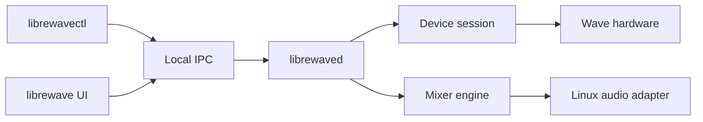

# Architecture

Status: approved baseline for the Linux implementation.

## Product boundary

LibreWave is a user-session audio service with two clients. The daemon owns the hardware, audio graph, saved state, and recovery process. The CLI and desktop application send commands to the daemon and subscribe to state changes.

This split lets the microphone and mixer continue to work when the desktop window is closed. It also keeps one normal hardware writer.

The local interface uses a Unix domain socket under the user's runtime directory. It does not listen on a network interface. The daemon checks the connecting process credentials and versions every request and event.

## Workspace boundaries

| Package | Responsibility | Must not contain |
| --- | --- | --- |
| `librewave-protocol` | Message schemas, codecs, field validation, generated protocol catalog | USB I/O, device policy, platform APIs |
| `librewave-device` | Device capabilities, exact-version sessions, state shadow, safe transactions | libusb, ALSA, PipeWire, UI code |
| `librewave-core` | Profiles, commands, events, channel identifiers, mix semantics | USB packets, platform object identifiers |
| `librewave-engine` | Audio graph semantics, DSP, metering, bounded control transfer | GUI state, blocking I/O, hardware policy |
| `librewave-ipc` | Versioned requests, responses, snapshots, subscriptions, errors | Device access, storage, platform APIs |
| `librewave-platform-linux` | USB transport, udev, ALSA, PipeWire, WirePlumber, hotplug | Product UI, cross-platform policy |
| `librewave-ui` | GPUI views, input handling, accessible controls | USB, ALSA, PipeWire, persistent authority |
| `librewaved` | Composition root, authority, reconciliation, recovery | Duplicated protocol or DSP logic |
| `librewavectl` | Complete command-line client, setup, diagnostics | A second hardware write path |
| `librewave` | Optional GPUI application | Required headless functionality |

Crates enter the workspace when they have a real contract and tests. The repository will not create empty platform crates as promises of future support.

## Dependency direction

`librewave-protocol` and `librewave-core` are the lowest layers. Device sessions depend on the protocol crate. The engine depends on core types. IPC depends on the stable command and event vocabulary in the core crate.

The Linux platform crate implements transport and audio-host traits. It may depend on the portable contracts, but portable crates do not depend on it.

The daemon composes these parts. The UI and CLI depend on IPC types and client code, not daemon internals.

## State ownership

The daemon maintains one desired state and one observed state for each managed device and audio graph.

- Desired state comes from the active profile and accepted user commands.
- Observed state comes from device reads, device events, and Linux audio events.
- Reconciliation compares the two states and schedules bounded changes.
- A successful write updates observed state only after readback or a trusted device event.
- A failed write leaves desired state intact and reports the mismatch.
- Each control event records whether it came from the device, a LibreWave client, or the operating system. Reconciliation does not send a change back to its origin.

The UI and CLI receive immutable snapshots followed by ordered events. They do not keep an independent authoritative device model.

Wave:3 hardware commands name one reviewed control and include the device generation shown by the daemon. The generation token contains a random daemon epoch and a device revision. The CLI uses the complete `epoch:revision` token shown by inspection. The epoch has 32 lowercase hexadecimal digits. A token from an earlier daemon process is stale, even when the device revision is the same. The daemon rejects a stale generation. The transaction path also reads the complete device configuration before every write. A physical change after the snapshot therefore causes a stale-baseline failure instead of a merge.

The daemon keeps one admitted Linux USB connection for each managed Wave:3. `librewavectl devices inspect <id>` reads the complete configuration again on that connection. `librewavectl refresh` sends the `Refresh` IPC command. The command first updates the host inventory. It then reads each retained connection that is ready or locked by ambiguous persistence, in logical device ID order. `GetStatus` and `ListDevices` update the host inventory but do not read a retained hardware configuration.

Host-service observations run on one read-only probe worker. The daemon collects completed results without waiting for that worker. Before the first result, service state is `not probed`. Each probe command has a 100 ms deadline and a 32 KiB limit for each output pipe. Timeout or cancellation terminates the probe process group and reaps the child. A failed status probe reports unavailable service state. A failed invocation probe reports no invocation identity.

Audio startup and recovery borrow the daemon's control owner for admission.
After checking that physical PipeWire nodes are hidden, each attempt reconciles
the exact inventory candidate and reads its complete configuration through the
retained claimed USB handle. If no connection exists, the daemon opens and
admits one through the same connection factory used by observation. A stale
candidate or failed read stops the attempt before any PCM opens.

The lifecycle creates a non-cloneable `AudioAdmission` context only after this
fresh check succeeds. Capture startup consumes that context. The audio backend
has no USB reader or handle and cannot release the daemon's control claim.
No admission result is cached for a later attempt. Configuration changes found
at this boundary update the normal device generation before IPC resumes.

An unchanged configuration read does not advance the snapshot generation or device generation. A changed read replaces the portable observed configuration, advances the device generation, and records `Device` as the origin. The read does not send a hardware write or change sparse desired state. A malformed read drops the retained connection and reports a failed admission. A disconnect also drops the connection and reports the device as disconnected.

A persistence-ambiguous connection stays retained and write-locked while configuration reads continue. A connection locked by failed or unverified restoration needs a new admission probe. Inspection drops that connection and uses the normal reopen, admission, and reconciliation path.

Desired hardware state contains only controls that a client explicitly changed through LibreWave. It is stored under the profile directory in one strict pre-release schema. A command is recorded as pending before USB access. The daemon promotes it to managed state only after verified apply or an unchanged result. A pending command after a crash locks restoration for that topology.

## Software inputs

The profile contains Microphone and System plus zero to ten named software inputs.
Software source IDs are 3 through 12. The daemon accepts a layout change only
while audio is stopped and cleanup is complete. It saves the complete profile
before publishing the new mixer generation. A stale request or failed save
leaves the retained layout unchanged.

Each configured software input has one deliberate virtual sink named
`librewave.input.<source-id>`. The Linux adapter builds a dense DSP port layout
for the exact profile, with at most 28 ports. It validates mapped buffers before
reading them. Each input has its own connection tracker and drops detached
samples from the first drain cycle. Scratch and source mappings are allocated
before processing. The graph callback uses fixed-capacity arrays and bounded
loops. Teardown removes every configured adapter and link after callback
quiescence. The public microphone endpoint remains independent of mix routes.

## Mixer controls

`SetMixerFaders` saves both channel levels in one profile revision and preserves
each route's mute state. The UI's link preference is a window editing option.
It does not create another saved mixer state or a second write path.

`SetMixerOutput` changes one software mix output. The complete control snapshot
contains source routes and both output controls. The engine applies the output
coefficient after the complete sum and before clipping and output metering.
The microphone endpoint bypasses these output controls. Coefficients are
compiled on the control thread. The callback consumes one fixed-size snapshot.

The current mixer state uses schema 2 and requires both output controls.
An earlier development profile is refused. The daemon does not reset or
convert it. Review and replace obsolete test state before launching this build.
The hardware and audio-intent formats are unchanged.

## Meter observation

`GetMeters` returns software peak and RMS values separately from control snapshots.
The existing real-time handoff holds one processed-block observation and never
blocks the producer. The daemon consumes it every 100 ms. It converts amplitudes
to linear millionths outside the audio callback and retains a transient frame.
A reading older than 350 ms becomes unavailable. Stop and a new audio attempt
clear the old frame. No meter value is saved or changes a device, mixer, or
profile generation. The CLI exposes `librewavectl mixer meters`.

## Application routing

The active graph observes playback streams through its existing PipeWire
registry connection. It groups streams by the stream node's `application.id`,
or by its `application.process.binary` when no valid application ID exists.
When the node has neither, the daemon reads the full properties of the client
that created the stream. It uses the client's `pipewire.access.portal.app_id`,
then `application.id`, then `application.process.binary`. PipeWire sets the
portal app ID from the sandbox, so a Flatpak application cannot change it. The
observed Flatpak Spotify stream names only `application.name` on its node and
is grouped as `com.spotify.Client`. The daemon does not use process IDs or
window titles. Streams without any of these identities remain unassigned. Observation is limited to 128 streams. Routing refuses an incomplete
list above that limit.

`GetApplications` returns a transient list. Its generation identifies the
daemon process, audio attempt, and registry revision. `RouteApplication` rejects
stale requests and permits only configured LibreWave input sinks. It writes
`target.object` in the default metadata. WirePlumber owns the resulting links.
LibreWave does not create application links or save a second assignment cache.
WirePlumber can remember targets according to its existing stream settings.

A move covers the group's currently observed streams. It remains pending until
every audio output port links only to the chosen input. Missing policy metadata,
disabled movement, and `node.dont-move` block the request. A changed stream group,
replaced input, desktop override, policy restart, or two-second timeout cancels
the move. Rollback restores an exact previous metadata value only while the
same stream incarnation retains the value written by LibreWave. Stop cancels
a pending move before graph teardown. No automatic retry fights the desktop.

The private PipeWire and WirePlumber test moves two silent playback streams to
one input and verifies their actual links. It also checks disabled movement.
Fakes cover stale generations, rollback, replacement IDs, and desktop overrides.
Real desktop application routing still needs controlled live validation. The
interface does not promise browser-tab identities or prevent initial audio from
reaching an application's previous destination.

## Device adoption

On first adoption, LibreWave reads the current device state as its observed baseline. It does not store every observed hardware field as desired state, and it does not reset the microphone to project defaults.

An explicit client command places that hardware control under LibreWave management. Unmanaged controls keep the value reported by the device. Automatic observation reads current values without restoring saved controls. Explicit inspection after automatic adoption restores managed controls once. Later inspection and refresh treat a changed configuration as device input.

The daemon checks the host inventory once per second and reads each admitted configuration at a 500 ms interval while it runs, including when audio is inactive or the window is closed. The control loop reads at most one device per turn and schedules the next read from completion. Reads serialize with transactions. A permission failure or disconnect retries after five seconds. A malformed or unsupported response requires explicit inspection or a new connection. Polling does not save profiles, restore desired controls, or enter the audio callback. An unchanged read leaves both generations unchanged. Each USB transfer has a 500 ms timeout, so a stalled device can delay control requests before it is dropped. The UI requests status every 500 ms; a physical change normally appears within about one second plus transfer and scheduling time.

An explicit unmanage operation releases the audio graph and restores setup files that LibreWave replaced. Setup does not change Gain Lock, so unmanage does not restore a saved Gain Lock value.

## Restart behavior

The daemon models startup, device reconnect, PipeWire restart, WirePlumber restart, and shutdown as state transitions. Recovery reuses the same reconciliation path as initial startup.

Reconnect first repeats exact model and API admission on a new connection. Automatic observation leaves the hardware unchanged. Explicit inspection can then restore managed controls in a fixed sequence of one-field, complete-payload transactions. This sequence is not atomic. If a later control fails, earlier verified controls can already be applied. The daemon reports the verified partial state and locks more writes. An unverified restoration reports no observed configuration. A disconnect drops the connection and reports the device as disconnected.

The daemon must not alternate between two competing graph layouts or repeatedly fight another volume owner. If the required ownership cannot be obtained, it reports the conflict and leaves hardware writes stopped.

## Installation ownership

`librewavectl` owns setup, verification, and removal. It records every installed path, backup, service unit, and policy file in one installation manifest. Setup stages a complete new installation, validates it, switches the active link atomically, and removes superseded LibreWave-owned files.

The current setup installs the exact Wave:3 udev access rule and an inactive daemon unit. It does not install the WirePlumber card-disable rule, enable the unit, start the daemon, or take audio ownership. `start --experimental` launches the installed unit and takes reversible audio ownership. Automatic login startup remains disabled until controlled recovery tests pass.

Uninstall removes only unmodified, manifest-owned paths and restores exact user files from verified backups. It preserves profiles by default. An explicit, confirmed purge removes profiles. Setup does not change Gain Lock or other hardware settings, so uninstall has no hardware value to restore.

The installation lifecycle records temporary policy and service changes in `runtime-manifest.json`. The daemon stores audio intent and the original configured defaults in `profiles/audio-state.json`. The clients use IPC to select or restore defaults. They never open the audio graph. A stopped daemon can reload an accepted audio intent after a crash. Stop cancels that intent before resource cleanup.

Development commands build the current checkout and call the same installer. They do not maintain a separate development installation path. See [Setup and removal](setup.md).

## Pre-release evolution

Before the first public release, the repository supports one current configuration schema, one IPC version, one command vocabulary, and one installation layout. The lifecycle refuses an unknown schema. A breaking development change replaces the only supported test layout instead of adding an adapter for an older development build.

Compatibility migrations begin only when a public release creates state that users need to keep.

## Platform precedent

Windows, macOS, and Linux use different audio APIs and virtual-device mechanisms. LibreWave shares the device model, mixer semantics, profiles, commands, and user-visible behavior where the evidence supports it. Each platform owns its audio graph and lifecycle code.

The project does not treat a shared implementation detail as a compatibility requirement. It records behavior at the operating-system boundary and reproduces that behavior through the native Linux stack. See [Wave Link behavior parity](behavior-parity.md).
