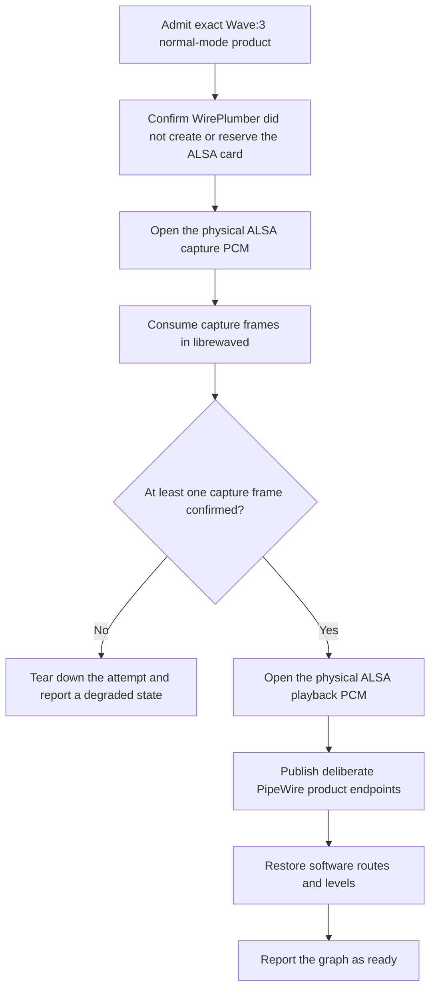

# Linux audio integration

Status: `librewaved` composes the ALSA workers, the independent-clock bridge, and the PipeWire graph into one audio attempt. A fresh daemon leaves audio inactive. Accepted audio intent survives a daemon restart. The CLI and GPUI start the installed service, can suspend one selected user fragment, and restore desktop ownership on stop. Private PipeWire tests use fake PCMs. A bounded Wave:3 run verified startup, software mixing, application moves, and exact restoration through `librewavectl stop`. Complete recovery, latency, and long-duration validation are not done.

## Reference system

The first test system uses Fedora 44, PipeWire 1.6, WirePlumber 0.5, KDE Plasma, and a Wave:3. Tests cover Wayland and X11 where desktop behavior differs.

## Ownership boundary

Some Wave microphones produce silent capture when playback starts before capture. A local Lua workaround confirmed the required order: it kept capture active through a null sink and created replacement playback and capture endpoints. A sanitized read-only PipeWire inspection showed that null sink in the ordinary sink list beside the replacement endpoints. LibreWave uses this as evidence for the order, not as its design.

LibreWave has one physical audio owner. Before each audio attempt, the daemon does a fresh configuration read through its claimed control connection and passes the validated candidate to capture startup. The audio backend opens no USB handle. An admission failure blocks PCM startup, and a restart or retry repeats the same check. `librewaved` opens the Wave:3 ALSA capture PCM directly, consumes capture frames, confirms that capture is active, and then opens the playback PCM. WirePlumber must not create or reserve the admitted physical card. PipeWire carries only the product endpoints that `librewave-core` defines.

`librewave-platform-linux` contains the policy artifacts, the ordered lifecycle, and the direct host. The host uses `alsa` 0.12.1 and `pipewire` 0.9.2. The PipeWire Rust crate does not wrap `pw_filter`, so a small C shim includes the installed PipeWire headers and owns only the ABI-sensitive filter event, hook, and process-position layouts. Rust owns graph policy, lifecycle, validation, and processing. The IPC command `StartAudio` connects this code to the daemon supervisor. Setup does not send it.

The host correlates the admitted USB candidate to one ALSA card. It requires one stable ALSA card identifier and one PCM device for each direction. It repeats the sysfs and procfs correlation immediately before each open, and the open uses the revalidated card identifier, device number, and subdevice zero. A changed card number, identifier, topology, or PCM set stops startup.

Wave:3 has one admitted physical PCM mode:

- Capture: interleaved packed signed S24_3LE, one channel, exactly 48 kHz.
- Playback: interleaved packed signed S24_3LE, two channels, exactly 48 kHz.

Capture and playback have independent period and buffer values. Each value must be nonzero, and each period must not exceed its buffer. Frame, sample, and byte calculations use checked arithmetic. ALSA must apply the full configuration without adjustment.

## WirePlumber policy

The Wave:3 policy renders `80-librewave-wave3.conf` as a WirePlumber 0.5 SPA-JSON fragment. Its one rule matches both exact normal-mode USB properties:

```text
device.vendor.id = "0x0fd9"
device.product.id = "0x0070"
```

The rule sets only `device.disabled = true`, which disables the exact card in the WirePlumber ALSA monitor. The fragment does not set `node.disabled`, create a node, load a component, or run a Lua script. WirePlumber documents `device.disabled` as the property that removes a matched card or device. See the [WirePlumber ALSA configuration reference](https://pipewire.pages.freedesktop.org/wireplumber/daemon/configuration/alsa.html).

The rule has no serial, name, family, class, or regular-expression match. A different vendor ID or an adjacent product ID does not match it.

Setup does not install this fragment. `librewavectl start` writes it to `wireplumber/wireplumber.conf.d/80-librewave-wave3.conf` under the configuration root after read-only admission, restarts WirePlumber, and records its ownership. `librewavectl stop` removes it after verified audio cleanup. Startup fails while WirePlumber still shows a physical Wave:3 Device or Node.

## Device access policy

The Wave:3 policy also renders `70-librewave-wave3.rules`. The udev rule matches the USB device object with vendor `0fd9` and product `0070`, then adds `TAG+="uaccess"`.

After the lifecycle installs or removes this rule, it reloads the udev rules. It then sends a change event only to normal-mode Wave:3 USB device objects with the same vendor and product values. It does not use a broad USB trigger. If the privileged rule or refresh operation fails, the lifecycle fails and does not claim that access is current. Rollback or journal recovery keeps or restores the prior rule state.

The rule does not use `MODE="0666"`. It does not match a USB class or interface, and it does not grant access to DFU or another product mode. `snd_usb_audio` stays bound during normal operation.

The installation manifest records the original ACLs of the connected nodes before the access rule applies. Removal restores those exact permissions after the udev refresh. A changed ACL or a new node incarnation stops cleanup and keeps the ownership records. See [Setup and removal](setup.md) for the connection limits.

## Startup sequence

The direct backend has one startup path:



The daemon does not open playback while capture is inactive or has produced no frames. A failed step tears down the objects from that attempt and reports a named degraded state. Recovery after hotplug or a PipeWire or WirePlumber restart uses the same sequence.

The lifecycle state machine enforces capture progress before playback preparation through one host trait. The daemon uses `ComposedAudioHost`. It runs the read-only Wave:3 API and schema admission probe, selects the exact ALSA card, starts capture, and waits for confirmed frames before it opens playback. It builds and activates the graph after playback is prepared. The playback worker starts its PCM only after one complete Monitor Mix period is queued. A startup error tears down the current attempt. The crate also has a fail-closed `LinuxAudioHost` that stops after PipeWire inspection. The daemon does not use it.

The capture worker owns one capture PCM and one `CaptureIngress`. It allocates its packed period buffer before the thread starts. Each completed read enters one capture boundary. The boundary advances the checked application ledger by the number of returned frames and stays in flight through status sampling and publication. The worker then takes one safe status snapshot for timestamp, availability, and signed delay. It reads the raw PCM state separately because `alsa` 0.12.1 does not give a checked state value through `Status`. ALSA can advance between those two calls, so the fault gate has a small sampling skew. The worker publishes exactly the returned prefix after all checks pass. If the short priming gate starts first, the worker keeps the prefix and retries the same boundary without reading or counting those frames again.

The playback worker owns one playback PCM, one `PlaybackEgress`, and its submitter. It can stay parked while the PCM is prepared. ALSA timestamp mode uses `CLOCK_MONOTONIC`, and playback uses the software boundary as its start threshold. Both settings must read back exactly. The submitter accepts one complete packed stereo period, including bounded partial writes, before the worker calls `snd_pcm_start` explicitly.

A finite ALSA wait that reports no readiness is a cancellation and no-progress point, not a worker fault. `EAGAIN` and `EINTR` use bounded retry counts with cancellation checks. `EPIPE`, `ESTRPIPE`, disconnect, invalid state, invalid geometry, timestamp regression, overflow, and other fatal errors end the attempt. The worker does not call ALSA recovery. The supervisor tears down the full attempt and restarts it from capture.

Worker shutdown requests cancellation and then joins the thread. The returned thread state holds the sole PCM owner. On the control thread, that owner calls `snd_pcm_drop` through the safe wrapper and reports the result. The wrapper is then destroyed on the same thread, and its RAII implementation releases the ALSA handle. `alsa` 0.12.1 does not report the result of the underlying `snd_pcm_close` call. The callback-reachable graph path does not own or release ALSA resources.

## Product endpoints

The desktop sees only these deliberate product endpoints:

| Endpoint ID | Display name | PipeWire node name | Flow | PipeWire direction | Media class |
| --- | --- | --- | --- | --- | --- |
| `System` | System | `librewave.system` | Public sink | Input | `Audio/Sink` |
| `Microphone` | Microphone | `librewave.microphone` | Public source | Output | `Audio/Source/Virtual` |
| `MonitorMix` | Monitor mix | `librewave.monitor-mix` | Public source | Output | `Audio/Source/Virtual` |
| `StreamMix` | Stream mix | `librewave.stream-mix` | Public source | Output | `Audio/Source/Virtual` |
| `Input` | Software input | `librewave.input.<source-id>` | Public sink | Input | `Audio/Sink` |

Each software input in the mixer profile has one `Input` endpoint. Its source ID is 3 or greater. All plans set `node.virtual=true`. Applications render to System or to a software input sink, and those frames supply the matching logical source. Physical Wave:3 capture supplies the Microphone logical source. The engine produces only Microphone, Monitor Mix, and Stream Mix output buffers. Monitor Mix is also the signal for physical headphone playback.

WirePlumber must create linkable session items for the product endpoints. LibreWave leaves `wireplumber.is-virtual` unset and uses `Audio/Source/Virtual` for the three source adapters. WirePlumber gives each source an `input_FL/FR` pair for the mixer and a `capture_FL/FR` pair for clients. Graph construction waits for these ports, then for 100 ms without a port change, before it creates permanent links. If the ports do not settle within two seconds, construction fails and the attempt tears down.

The physical Wave capture and playback PCMs are not desktop endpoints. LibreWave must not publish a keepalive sink, null sink, raw helper source, duplicate physical Wave node, or another implementation object as an ordinary device. KDE, `wpctl status`, and PulseAudio-compatible listings form the visibility acceptance test. Low-level diagnostic tools can still show internal objects.

The host connects to the existing `pipewire-0` instance of the user and completes a registry round trip. It checks the exact ALSA card number of the admitted candidate. A Device matches when it has the Wave:3 vendor and product values and its `api.alsa.card` value identifies that card. A Node matches through the card component of `api.alsa.path` and does not need vendor or product properties. On the reference desktop, registry global properties do not carry the card identity, so the host binds registry objects and reads their complete properties. Startup fails while any matching Device or Node is visible.

Each physical-object check uses a new PipeWire connection. The check binds Node and Device proxies, reads their complete properties, and then releases the proxies and the connection. This keeps asynchronous proxy errors out of later ownership checks.

Endpoint plans come only from `librewave-core`. `ComposedAudioHost` uses that allowlist and one graph callback. It reports the graph ready only after both workers park, the bridge activates, and both workers resume.

## Application routing

The router identifies a playback stream by its desktop application ID or executable. A native application matches by executable and a Flatpak by its app ID. When the stream node has no identity, the router reads the owning PipeWire client: first `pipewire.access.portal.app_id`, then `application.id`, then `application.process.binary`.

An application move writes the `object.serial` of the observed software input to `target.object` with type `Spa:Id`. The serial identifies the current node. The router rejects missing or replaced inputs and checks every audio link before it reports a verified move. Conditional rollback keeps independent metadata changes.

The WirePlumber stream restoration hook resolves this serial and saves the stable node name. On a new stream, it resolves that name to the current serial. Inputs can therefore be recreated without LibreWave keeping stale node identities. Explicit application targets and disabled target restoration can prevent restoration. LibreWave does not change the global restoration setting.

A private PipeWire and WirePlumber test moved a silent stream and checked the saved target. It then recreated the stream, recreated the input, and restarted WirePlumber. The stream returned to the assigned input with a new input serial. The test uses private state and no ALSA device. Run it separately and serially:

```text
LIBREWAVE_PIPEWIRE_INTEGRATION=1 cargo test -p librewave-platform-linux --lib private_application_ -- --ignored --test-threads=1
```

Real desktop routing and restart acceptance are not done.

## PipeWire graph

`ComposedAudioHost` owns the graph during one audio attempt.

The System `Audio/Sink` node is the PipeWire driver. Its permanent monitor links keep the graph active when no application renders to System. Microphone, Monitor Mix, and Stream Mix are `Audio/Source` nodes. A separate filter node owns the mixer callback and its planar F32 ports. That node has no `Audio/Sink` or `Audio/Source` media class. With no software inputs, the graph has five nodes, eight ports, and eight permanent links. The client creates all nodes and permanent links while the filter is inactive, validates the observed graph, and activates the filter once. It does not create a hidden driver, timer, server configuration, lingering object, or helper endpoint.

One callback receives the graph driver ID, rate, position, quantum, the System and software input buffers, and six output buffers. The callback accepts 48 kHz and one fixed quantum for each attempt. A missing buffer, PipeWire error or disconnect, pause, driver change, rate change, quantum change, position discontinuity, overlapping or invalid buffer range, processor error, or panic fails that attempt. A fixed-capacity atomic record carries fault details to the control thread. The callback does not tear down the graph.

System link state uses a generation published from registry events. A producer attach has one priming quantum, and a detach has one drain quantum. The mixer treats System as disconnected during that drain quantum and later idle cycles. PipeWire can leave old samples in a detached adapter buffer, so the mixer does not use that buffer after link removal. The test removes producer links before it deactivates the producer.

The private integration tests start their own PipeWire daemon with temporary runtime and configuration directories and a private remote name. They do not use ALSA, USB, user services, or persistent configuration. Tests that need policy start a private WirePlumber. The graph test repeats the full lifecycle at fixed quanta of 64, 128, 256, and 512 frames. It verifies the four endpoint classes, the hidden filter, all eight F32 ports, one System driver ID, continuous graph position, deterministic mixer vectors, idle processing, producer and consumer churn, one priming quantum, one drain quantum, and zero residual LibreWave objects. The fake producer can receive mapped ports after its first callback. Each System channel must then carry a continuous producer vector with no more than two quanta of adapter delay, and the channels can have different offsets during link startup. Filter output reaches all three source adapters in the same graph cycle.

A separate test changes the live quantum from 128 to 64 frames. PipeWire pauses the filter before it delivers a block with the new quantum. The graph records that pause as an attempt fault and tears down. Live quantum changes are not seamless.

Prerequisite: the host has the PipeWire development files, `pipewire`, `pw-cli`, and `pw-metadata`. Run each private test separately:

```text
LIBREWAVE_PIPEWIRE_INTEGRATION=1 cargo test -p librewave-platform-linux audio_host::pipewire_graph::tests::integration::private_desktop_defaults_are_selected_and_restored -- --ignored --exact --test-threads=1
LIBREWAVE_PIPEWIRE_INTEGRATION=1 cargo test -p librewave-platform-linux audio_host::pipewire_graph::tests::integration::private_pipewire_graph -- --ignored --exact --test-threads=1
LIBREWAVE_PIPEWIRE_INTEGRATION=1 cargo test -p librewave-platform-linux audio_host::pipewire_graph::tests::integration::private_composed_audio_attempt -- --ignored --exact --test-threads=1
LIBREWAVE_PIPEWIRE_INTEGRATION=1 cargo test -p librewave-platform-linux audio_host::pipewire_graph::tests::integration::private_existing_physical_node_blocks_ownership -- --ignored --exact --test-threads=1
LIBREWAVE_PIPEWIRE_INTEGRATION=1 cargo test -p librewave-platform-linux audio_host::pipewire_graph::tests::integration::private_wireplumber_routes_a_named_player_to_system -- --ignored --exact --test-threads=1
```

The desktop tests use the active PipeWire session and WirePlumber of the user. Run them separately:

```text
LIBREWAVE_DESKTOP_PIPEWIRE_INTEGRATION=1 cargo test -p librewave-platform-linux audio_host::pipewire_graph::tests::integration::desktop_pipewire_keeps_all_filter_buffers_mapped -- --ignored --exact --test-threads=1
LIBREWAVE_DESKTOP_PIPEWIRE_INTEGRATION=1 cargo test -p librewave-platform-linux audio_host::pipewire_graph::tests::integration::desktop_pipewire_routes_named_streams_without_manual_links -- --ignored --exact --test-threads=1
```

The default test suite does not start a daemon and does not silently skip these tests. CI does not run them because the runner does not install the PipeWire daemon tools. They need a fixed PipeWire runtime image and a separate serial CI job.

## Portable mixer contract

`librewave-engine` processes stereo interleaved 32-bit float audio at 48 kHz. Construction sets a portable logical source collection with at most 12 sources, the microphone source, and the maximum frame count for one call. Each call can use any frame count up to that maximum. The Linux adapter bridges ALSA periods and PipeWire quantum sizes to this contract.

Each source has separate monitor and stream routes. A route has an enabled value and a fader from -60.0 dB through +12.0 dB in 0.5 dB steps. The Monitor Mix and Stream Mix outputs also have an enabled value and a level with the same range. The microphone endpoint receives the configured microphone source at unity, and monitor and stream route values do not change it. Hardware microphone gain, hardware microphone mute, and headphone level stay outside the engine.

The engine reports separate left and right peak and RMS values for each source and endpoint. It applies one complete pending control snapshot at the boundary before a nonzero block. Processing uses fixed-capacity state and does not allocate, free memory, lock, block, log, perform I/O, or call platform code.

## Graph-clock bridge

The bridge models three independent clocks: Wave capture, the PipeWire graph, and Wave playback. It does not assume a shared clock for the two Wave directions. The PipeWire graph position is the only clock for `MixerEngine`. System and the software inputs are direct graph-time inputs. Microphone, Monitor Mix, and Stream Mix are direct graph-time outputs.

Every clock sample uses a typed nonzero attempt epoch, an integer frame position, and integer nanoseconds from a monotonic clock. It does not use wall time or a floating-point timestamp. A graph observation also has a positive quantum. The Linux graph processor accepts one fixed quantum for each attempt. That rule is Linux policy. The portable estimator accepts any positive frame and time deltas within caller-selected bounds.

The capture side accepts a checked capture observation, a complete frame count, and mono packed S24_3LE data. `CaptureIngress` keeps a separate application frame ledger. The observed hardware position must be at or beyond the completed application position. A greater hardware position is valid because ALSA capture availability can contain unread frames. A hardware position behind the application position faults the attempt before the FIFO, application ledger, last observation, or observation handoff changes. The decoder sign-extends each 24-bit value and produces finite mono `f32` samples.

The capture worker publishes complete blocks to a bounded single-producer, single-consumer FIFO. It also offers checked observations to a one-slot handoff that never overwrites an unread observation. If the slot is full, the new observation is not published. The graph processor consumes an observation only when its full boundary can commit.

The graph processor has one lifecycle-driven `process` boundary for startup and active work. It copies the required capture frames into preallocated scratch without advancing the published read sequence. Its capture-to-graph estimator measures `graph_rate / capture_rate` as `(graph_frames * capture_nanoseconds) / (capture_frames * graph_nanoseconds)`. Checked `u128` cross-products come before the floating-point division. The estimator preview does not change history.

The playback side takes the stereo Monitor Mix output from the same graph boundary. The graph processor offers each graph observation to another one-slot, no-overwrite handoff and publishes Monitor Mix to the playback FIFO. `PlaybackEgress` has one lifecycle-driven `process` boundary. Its independent graph-to-playback estimator measures `playback_rate / graph_rate` as `(playback_frames * graph_nanoseconds) / (graph_frames * playback_nanoseconds)`.

Each direction owns one estimator, one FIFO phase controller, and one rate matcher. After estimator priming, the controller requires a measured feed-forward ratio. It computes `final_ratio = measured_feed_forward * fifo_phase_trim`, then applies the final-ratio slew and bounds. Invalid measurements, non-finite arithmetic, and policy violations fault the attempt. The code does not clamp them or replace them with 1.0. The controller `ratio()` value is the final ratio applied to the matcher.

FIFO ownership is fixed. `CaptureIngress` is the sole capture producer, and `GraphClockProcessor` is its sole consumer. `GraphClockProcessor` is the sole playback producer, and `PlaybackEgress` is its sole consumer. Each FIFO has monotonic published read and write frame sequences, and these are the only source for fill and free-space values. A producer copies a complete block before a commit publishes the next write sequence. A consumer can copy a complete block without publishing the next read sequence. Dropping either prepared operation leaves its sequence unchanged.

Construction checks both sides of each FIFO operating range. The low-water guard must hold the maximum matcher input. At the high-water guard, the capture FIFO must have space for one full physical capture period, and the playback FIFO must have space for one maximum graph quantum. Construction uses checked arithmetic and fails before processing if either condition does not hold.

The graph processor commits the capture FIFO, capture observation, graph observation, capture estimator, capture controller, and graph position only after capture ASRC, mixer processing, finite output validation, and complete Monitor Mix admission to the playback FIFO all succeed. `PlaybackEgress` commits its FIFO, graph observation, playback estimator, playback controller, and hardware observation only after a complete packed period reaches the submitter. If a terminal write follows partial acceptance, only the playback application ledger advances by the accepted frames. The FIFO and estimator transaction does not commit, and the attempt faults. A matcher can change internal state before a later boundary fails. Such a failure is terminal, so the attempt cannot retry with partly changed dependency state.

Playback submission and playback hardware movement are separate facts. A successful submitter call advances only the application frame ledger. The next safe status snapshot supplies the next playback observation. The worker does not attach a post-write status to the completed submission cycle. During active processing, repeated or regressing hardware progress faults the attempt. The playback code does not infer hardware progress from a successful submission and does not parse the USB feedback endpoint.

For capture, `capture_ring_hw = capture_appl_total + capture_avail`. The result must not precede completed application progress. For playback, `queued_ring_frames = buffer_frames - playback_avail`, then `playback_ring_hw = playback_appl_total - queued_ring_frames`. Availability must fit the exact configured buffer. Signed ALSA delay is separate diagnostic data and can be negative. Seconds, nanoseconds, and all position conversions use checked arithmetic.

The startup states are `Allocated`, `CapturePriming`, `CaptureFilterDelay`, `CaptureEstimatorPriming`, `PlaybackPriming`, `PlaybackFilterDelay`, `PlaybackEstimatorPriming`, `PlaybackStabilizing`, `PrimingCheck`, and `Primed`. After a playback hardware-progress sample, the playback owner closes the `PrimingCheck` gate and commits its boundary. New capture and playback processing waits, and the graph callback emits silence. The control owner waits for earlier processing boundaries to finish, then reads both fill values from stable published sequences. It returns to `PlaybackStabilizing` if either fill is outside its guard. Holding the gate prevents repeated misses when playback and graph boundaries stay aligned. Activation uses the same gate to verify that all three owners are outside a boundary. If a silent graph callback is in flight at activation, the host retries within the startup deadline.

The matcher ratio is exactly 1.0 only in the named filter-delay and estimator-priming states. The applicable controller does not preview or commit in those states. An estimator can commit explicit priming observations, but it does not invent a measured ratio. If a dependency delay ends inside a graph quantum or playback period, the bridge discards that complete boundary instead of trimming it. Complete playback boundaries stay startup work in `PlaybackStabilizing` until both FIFO guards and observed hardware progress permit `Primed`. No delay discard occurs in `Primed` or `Active`.

`Primed` means that the bridge startup checks are complete. It does not alone mean that an endpoint or PCM path is ready. Both workers park in this state without starting another boundary, but they keep sole ownership of their PCM and bridge endpoint. The graph callback emits silence during `Primed`, `PrimingCheck`, and quiescing. It still advances and validates the graph clock, so the first `Active` boundary sees a continuous position. After the control owner changes the bridge to `Active`, it resumes both worker threads. A stop request also wakes a parked worker. A fault moves the attempt to `Faulted`. Teardown moves it to `Quiescing`, waits for the capture, graph, and playback owners to leave their boundaries, then moves it to `Stopped`.

An unconnected System endpoint has semantic silence. A connected System endpoint must supply two complete, finite graph-time buffers. Missing active System data is a fault, and so is missing capture or playback bridge data. Other terminal faults include FIFO overflow, unsupported or adjusted physical format, invalid quantum or period, packed sample errors, position overflow or discontinuity, estimator or controller failure, ASRC failure, submission failure, incomplete submission, and teardown before quiescence. The active path has no sample drop, sample insertion, fixed-ratio fallback, or unbounded queue.

Construction allocates and warms both rate matchers, audio scratch, FIFOs, observation handoffs, the control handoff, the meter handoff, and the packed playback buffer. The graph boundary does not allocate, deallocate, block, log, perform USB or file I/O, create a thread, panic, or acquire an unbounded lock. Mixer changes use the bounded control stager. Meter reports use the bounded, nonblocking handoff.

Tests choose FIFO capacities, guard values, estimator spans, controller gains, and ratio bounds as named simulation values, not product policy. One checked frame-ledger and controller simulation covers 24 simulated hours in both drift directions. A shorter test runs real mono and stereo sinc ASRC with independent positive and negative drift. The frame-ledger test checks arithmetic and control stability only, not sinc sample quality. Other tests cover every graph quantum from 64 through 1024 frames, including non-multiple values, packed S24_3LE conversion, sample order, startup delay, clock faults, transaction commit rules, zero real-time allocation or deallocation, and quiescent teardown. Worker fakes also cover partial reads and writes, bounded transient retries, wait timeouts, signed delay, timestamp conversion, terminal ALSA states, explicit playback start order, deterministic parking and resume, stream drop, and RAII handle release.

## Attempt supervision and policy

`ComposedAudioHost` composes both workers, the bridge, and the PipeWire callback. Its control-side startup gates have an eight-second deadline. After activation, capture, playback, and graph progress each have a one-second watchdog. IPC frame transfers have absolute deadlines. The daemon keeps its supervision ticks running between nonblocking reads and writes, including while a client sends an incomplete frame. Read-only service probes run off the owner thread. A stopped worker, bridge fault, callback fault, missing physical-node hiding rule, changed device, or changed host-service invocation tears down the attempt. A cleanup failure blocks a replacement. The daemon retries a clean failure after two seconds. The default test suite opens no live ALSA or desktop PipeWire object.

The daemon uses one named conservative policy:

| Value | Setting |
| --- | --- |
| Capture period and buffer | 1,024 and 8,192 frames |
| Playback period and buffer | 256 and 2,048 frames |
| Graph quantum | 256 frames, fixed |
| Bridge FIFO capacity, target, startup guard | 16,384, 8,192, and 4,096 frames |
| Rate ratio range | 0.98 through 1.02 |
| Capture rate estimate minimum | 8,192 frames and 160 ms |
| Playback rate estimate minimum | 32,768 frames and 640 ms |
| ALSA wait and transient retries | 10 ms, four retries |

Capture admission advances at 4,096 queued frames. The final guard check still uses the 8,192-frame target. Playback checks both FIFO fills before it pauses the graph for that check. These values favor startup headroom. They are not measured latency settings. The daemon reloads accepted audio intent from its strict audio-state file after a restart.

## Software performance checks

Prerequisite: use the repository toolchain and dependencies in [Setup](setup.md). The performance example uses generated samples. It opens no USB device, ALSA PCM, PipeWire connection, or session service.

```text
cargo run --release -p librewave-engine --example audio_performance
```

The command writes a JSON report to standard output. It runs the real mixer with meters at two and twelve sources, plus mono and stereo sinc resampling. Each shape uses 64, 128, 256, 512, and 1024 output frames. It warms each shape for 128 blocks and measures 4096 blocks. Output checks reject an incorrect mixer sum, non-finite samples, or incomplete resampling output.

The report gives the median, p99, and maximum call time, and the number of calls that take longer than one audio period. Timing includes timer overhead and scheduler preemption, and calls run without pacing. These values measure software processing cost, not a scheduled audio callback or hardware round-trip latency. The reported output delay of the sinc dependency is a separate frame count and does not include FIFO, PCM, USB, or acoustic delay. The report shows timing overruns instead of using them as a machine-dependent unit-test threshold.

The private PipeWire fixture can also check five graph rebuilds after server loss. It starts and stops only its private server, opens no USB device or ALSA PCM, and does not change desktop defaults or services. Run it separately and serially:

```text
LIBREWAVE_PIPEWIRE_INTEGRATION=1 cargo test -p librewave-platform-linux --lib audio_host::pipewire_graph::tests::integration::private_graph_rebuilds_after_repeated_server_loss -- --ignored --exact --test-threads=1
```

Each cycle requires working processing, one instance of each product node, quiescent teardown after server loss, and idempotent release. This shows graph reconstruction in the private fixture only. Hardware and desktop recovery need their own acceptance runs.

## Mixer control plane

The mixer profile has two fixed logical sources: source 1 is Microphone and source 2 is System. Source 1 supplies the microphone endpoint. Software inputs use source IDs from 3 upward, up to 12 sources in total. Levels use integer half-decibel steps from -60 dB through +12 dB.

With no saved profile, the daemon creates the first-run profile. It has the inputs Microphone, System, Music, Browser, Voice Chat, and Game. Every route starts enabled at 0 dB, except the Microphone monitor route, which starts disabled. The daemon assigns detected installed applications to these inputs by their desktop-entry `Categories`, in this order:

| Categories | Input |
| --- | --- |
| `Game` | Game |
| `InstantMessaging`, `Chat`, `Telephony`, or `VideoConference` | Voice Chat |
| `WebBrowser` | Browser |
| `Music`, or `Audio` and `Player` without `Video` | Music |

`librewavectl mixer reset <generation>` (IPC `ResetMixer`) restores these defaults. The default inputs get new source IDs, so no existing endpoint changes its meaning. Hardware controls do not change.

`librewaved` stores the desired profile in `librewave/profiles/mixer-state.json` under the configuration root. The file has schema 3 and contains the mixer generation, the next source ID, application assignments, the microphone source, all sources, and the output controls. The daemon rejects unknown fields, unsupported schemas, changed fixed-source identities, and invalid fader steps.

`librewavectl mixer show` reads the current snapshot. `librewavectl mixer set <source-id> <generation> <monitor|stream> <on|off> <level-db>` replaces one complete route. Other `mixer` and `apps` commands are listed by `librewavectl help`. The daemon rejects a stale mixer generation or an unknown source. An unchanged route succeeds without a file write or a generation change.

For a changed profile, the daemon writes the complete profile to a temporary file, syncs it, renames it, and syncs the profile directory. It updates retained state only after all these steps succeed. If the directory sync fails after the rename, the command reports durability ambiguity and retained state does not advance. The destination can already contain the next complete profile. A retry with the retained generation writes the same profile and makes the file and snapshot agree. At startup, the daemon strictly loads whichever complete file is present.

A mixer snapshot is inactive until the lifecycle reaches `Ready`, and its meter values are unavailable while inactive. A later fault makes it inactive again. Mixer commands save desired state and, when an attempt is active, stage a complete profile at a graph boundary. They do not enable the daemon service or start audio.

## Live input changes

The control handoff supports prepare, commit, and cancel. Preparation reserves one complete control snapshot, and the audio thread keeps the previous controls until commit. Dropping a prepared transaction releases its slot without publishing the change. A second producer operation cannot overwrite a prepared or published snapshot.

Software inputs map to ten fixed DSP slots. The filter boundary tells a reserved slot from an active input. Each reserved input port uses a separate zero buffer allocated before graph activation. Active inputs still need valid PipeWire buffers. System, output, timing, and buffer-range checks always apply. Each successful callback acknowledges the input-mask transaction number. A failed callback does not.

The daemon prepares endpoint resources and a fixed-slot control update before it saves the profile. A failed save cancels the prepared resources. On commit, removed slots become silent at an acknowledged block boundary before their links and nodes are released. Unaffected inputs keep their slots and nodes. If the graph fails after the save, the daemon reports an inactive mixer and recovers from the saved profile. It does not report a ready graph.

Software tests cover 1,024 repeated input-mask changes with no allocation, reallocation, or deallocation inside the callback. A known signal on an unaffected input stays in the simulated output. These are callback simulations, not live endpoint edits. A separate opt-in test runs 12 add and remove cycles on an isolated PipeWire server, including preparation cancellation and channel IDs above 12. It verifies unchanged core node IDs and removal of canceled endpoints. The composed-host test also passes with reserved slots. These tests do not use the Wave:3 or the desktop audio session.

## Volume ownership

The Linux audio graph keeps these values separate:

- Microphone preamp gain is a Wave hardware value.
- Headphone output level is a Wave hardware value.
- LibreWave endpoint, channel, and mix volumes are software values.
- A raw ALSA hardware mixer value is not a LibreWave endpoint value.

KDE can change the software volumes that LibreWave publishes. It must not use ALSA hardware controls as those endpoint values. The device control path and accepted physical events are the only routes to the microphone preamp and headphone level.

A sanitized read-only ALSA inspection found `Mic Capture Volume` at 0.00 to 40.00 dB in 0.5 dB steps and `PCM Playback Volume` at -60.00 to 0.00 dB in 0.5 dB steps. Their switches and read-only channel maps belong to the same physical control groups. These controls are hardware aliases for microphone gain and headphone level. LibreWave keeps them out of software endpoint volume and mute semantics.

Gain Lock is an optional Wave hardware setting. LibreWave reads and preserves it, and the user can change it through the hardware settings. Setup does not enable it. Gain Lock does not disable software volume on the LibreWave microphone endpoint.

Volume events carry an origin. A physical knob event can update hardware state and the UI without a write back to the device. A KDE software-volume event can update the matching LibreWave endpoint without reaching the ALSA hardware mixer. This prevents feedback loops and gives each value one owner.

The final mapping must also match the observed Wave Link behavior on Windows and macOS. See [Wave Link behavior parity](behavior-parity.md).

## Setup, start, and stop

`librewavectl setup` shows its plan before it changes the system. It stages the current CLI and daemon, switches stable links, installs a disabled and inactive daemon unit, and asks for elevation only for the exact udev access rule. When the desktop client is requested, it also installs `~/.local/bin/librewave`, `com.zhgmx.LibreWave.desktop`, an autostart entry, `librewave-desktop.service`, and the icon `~/.local/share/icons/hicolor/scalable/apps/com.zhgmx.LibreWave.svg`. The installation manifest has schema 6. Setup does not install the WirePlumber fragment, start the daemon, open ALSA, or publish PipeWire objects.

`librewavectl start [--suspend-config <PATH>]` takes audio ownership. It refuses to run when automatic daemon startup is enabled. It starts the installed service, runs read-only admission, captures the current desktop defaults, and backs up and removes the selected user fragment when one is given. It then installs the WirePlumber fragment, restarts WirePlumber, sends `StartAudio`, waits for a ready mixer, and selects the LibreWave System sink and Microphone source as desktop defaults. If any step fails, it restores the prior desktop ownership. `librewave-desktop.service` runs `librewavectl start` before it starts the GUI.

`librewavectl stop` sends `StopAudio`, waits until no LibreWave audio node remains, removes the WirePlumber fragment, restores the suspended fragment, restarts WirePlumber, and restores the captured desktop defaults. `librewavectl audio start` and `librewavectl audio stop` send only `StartAudio` and `StopAudio` to a running daemon.

`librewavectl doctor` reports graph inspection as blocked, because the CLI never opens PipeWire directly. The lifecycle contract in [Setup, development installs, and removal](setup.md) governs installation, rollback, diagnostics, and removal.

## Open validation

The ASRC bridge and both ALSA worker directions pass offline tests, and the composed host passes private PipeWire tests. Support claims need all of these results on the reference system:

- `librewaved` owns the physical capture and playback PCMs directly.
- Capture consumption produces confirmed frames before playback opens.
- Native ALSA capture and playback status behavior matches the safe API assumptions in the typed observations.
- PipeWire source and sink directions come from `librewave-core`, and endpoint audio reaches the daemon-owned mixer.
- No helper, null sink, or physical Wave node appears as a desktop device.
- Restart, reconnect, sleep, login, teardown, and rollback tests pass.
- Software volume changes cannot write microphone gain or headphone hardware level.

Native validation must confirm PCM timestamp, availability, delay, state, partial I/O, and disconnect behavior. `EPIPE` and `ESTRPIPE` are terminal attempt faults. Recovery releases the failed attempt and uses the full capture-first startup sequence.

A confirmed PipeWire core disconnect releases the local graph without waiting for a reply from the disconnected server. Teardown still destroys the local filter and waits for callback quiescence. A timeout without a confirmed disconnect is a cleanup failure and blocks a replacement attempt.

Do not claim Linux audio backend support until these tests pass.

## Acceptance tests

- Log in with the Wave:3 already connected.
- Log in with the Wave:3 disconnected, then connect it.
- Disconnect and reconnect during capture and playback.
- Restart PipeWire.
- Restart WirePlumber.
- Stop and restart `librewaved`.
- Change KDE microphone and output volumes.
- Change the physical Wave:3 knob in each control mode.
- Confirm that only deliberate endpoints appear in KDE and `wpctl status`.
- Confirm that saved microphone gain and headphone level survive every recovery case.
- Install a new development build over an older one and confirm that every running path refers to the new build.
- Uninstall and confirm that manifest-owned paths are removed, replaced files are restored, profiles are preserved, and no LibreWave process, unit, rule, or node remains.
